# Plan: Plataforma cuantitativa institucional (FastAPI → trading platform completo)

## Objetivo

Transformar el proyecto actual de analítica de riesgo (FastAPI, VaR/ES/Monte Carlo, alpha mining Zoomcamp) en una plataforma de trading cuantitativa institucional con pipelines de ML, ingeniería de features, múltiples estrategias, backtesting walk-forward, métricas de rendimiento y optimización de cartera — sin romper los endpoints v1 existentes.

## Contexto verificado (estado actual)

- Repo: `C:\stock analytics 2026\project` (FastAPI + Python 3.10+).
- Capa API: `app/main.py`, routers v1 (`health, assets, risk, stress, monte-carlo, portfolio, alpha`), schemas Pydantic v2, `Depends` DI, logging estructurado, fallback demo semilla 42.
- Servicios existentes: `data_engine.py` (yfinance + caché CSV), `risk_engine.py` (VaR/ES/MDD), `stress_testing.py`, `monte_carlo.py`, `portfolio.py`.
- Módulo Alpha Mining ya presente: `app/alpha/` (hipótesis, backtest, DSR/PBO, walk-forward) expuesto en `/api/v1/alpha`.
- Frontend: `streamlit_app/` (6 pestañas sobre la API).
- Tests: `pytest tests/ -v --cov=app` (35 tests), `conftest.py` con fixtures sintéticas.
- Docs: `README.md`, `openapi.yaml`, `docs/requirements/Capítulos 1-4 y 11`, `docs/architecture.md`, `docs/coding_standards.md`, `docs/ai-workflow.md`, `docs/criteria/`.
- Rúbrica actual (README scoring map): Documentación 2/2, Reproducibilidad 2/2, Testing 2/2; Containerización 1/2 (sin Dockerfile obligatorio), Deployment 1/2, CI/CD 1/3, Observabilidad 1/2, Reviewer Evidence 1/2.

## Decisiones de diseño (recomendadas, resueltas en este plan)

| # | Decisión | Recomendación | Motivo |
|---|----------|---------------|--------|
| D1 | Universo de activos | Expandir a ~15-20 tickers líquidos (SPY, QQQ, IWM, EEM, GLD, TLH, SLV, USO, BTC-USD, ETH-USD, SOL-USD) manteniendo ZS=F, BZ=F, YPF y cripto existentes | ML y estrategias necesitan activo amplio y líquido; se conservan los activos ARG para riesgo existente |
| D2 | Almacenamiento | Parquet particionado (`data/raw/`) + catálogo SQLite (`data/catalog.db`); caché CSV actual se mantiene como fallback | Lectura rápida de series históricas, trazabilidad de runs/señales, sin depender de red en cada ejecución |
| D3 | Stack ML | scikit-learn (Random Forest, Regresión Logística), XGBoost, LightGBM, TensorFlow/Keras (LSTM) | Madurez en series temporales, modelo por modelo independiente, LSTM con Keras es más estable que PyTorch para este alcance |
| D4 | Capa de código nueva | `app/quant/` bajo `app/` (mismo paquete, imports `app.quant.*`); nuevos routers en `app/api/v2/` | No toca código existente; v1 sigue funcionando; v2 expone ML/estrategias/backtest/optimización |
| D5 | Validación walk-forward | Expurgo (embargo) de 5 días entre train/test, `TimeSeriesSplit` personalizado, métrica OOS honesta | Evita fuga de datos (look-ahead bias); coherente con `EMBARGO_DAYS = 5` del módulo alpha |
| D6 | Métricas de estrategia | CAGR, Sharpe, Sortino, Max Drawdown, Win Rate, Profit Factor, Alpha, Beta (vs SPY) | Cubre el requisito completo y alinea con métricas del módulo alpha |
| D7 | Despliegue | `docker/Dockerfile` + `docker-compose.yml` (API + worker opcional) | Sube Containerización 1/2 → 2/2 y Deployment 1/2 → 2/2 en la rúbrica |
| D8 | CI/CD | GitHub Actions (`.github/workflows/ci.yml`): lint, type-check (mypy), pytest con cobertura, build de imagen | Sube CI/CD 1/3 → 3/3 |
| D9 | Observabilidad | Métricas Prometheus (`prometheus_client`) en `/metrics`, logging estructurado existente, health extendido | Sube Observabilidad 1/2 → 2/2 |
| D10 | Migración/rollout | Aditivo: ningún endpoint v1 modificado; v2 montado bajo `/api/v2`; requirements se extienden, no se reemplazan | Cero riesgo de regresión sobre lo entregado |

## Arquitectura (diagramas Mermaid)

### Capas de la plataforma

```mermaid
flowchart TB
    subgraph Clients["Clientes / Revisores"]
        C1[curl / Swagger UI]
        C2[Streamlit frontend]
        C3[Scripts CLI / notebooks]
    end

    subgraph API["API Gateway (FastAPI + uvicorn)"]
        A1[main.py]
        A2[Routers v1: salud, activos, riesgo, estrés, MC, cartera, alpha]
        A3[Routers v2 (NUEVO): ml, features, targets, strategies, backtest, optimization, portfolio]
        A4[Depends: DI de servicios y configuración]
    end

    subgraph Services["Capa de servicios cuantitativos (app/quant/)"]
        S1[data_engine: ingestión yfinance + parquet/SQLite]
        S2[feature_engine: retornos, vol, RSI, MACD, BB, ATR, momentum, volumen, régimen, corr. benchmark]
        S3[target_engine: 24h >1%, retorno 7d, vol forecast, riesgo de drawdown]
        S4[ml_models: RF, XGB, LGBM, LR, LSTM + registry]
        S5[backtest_engine: walk-forward, capital, costos, slippaje, sizing]
        S6[strategies: long-only, long-short, Top-K, régimen, risk parity, adaptativa]
        S7[optimization: MVO, risk parity, max diversificación, Kelly]
        S8[risk_engine: VaR, ES, MDD (existente, reutilizado)]
    end

    subgraph Storage["Almacenamiento"]
        ST1[Parquet particionado: data/raw/]
        ST2[Catálogo SQLite: data/catalog.db (metadatos, runs, señales)]
        ST3[Caché CSV legacy: data/cache/ (fallback)]
    end

    subgraph External["Fuentes externas"]
        E1[yfinance]
        E2[Datos demo determinísticos (fallback, seed 42)]
    end

    C1 --> A1
    C2 --> A1
    C3 --> A1
    A1 --> A2
    A1 --> A3
    A2 --> S1
    A2 --> S8
    A3 --> S2
    A3 --> S3
    A3 --> S4
    A3 --> S5
    A3 --> S6
    A3 --> S7
    S1 --> ST1
    S1 --> ST2
    S1 --> ST3
    S2 --> ST1
    S3 --> ST1
    S4 --> ST2
    S5 --> ST2
    S6 --> ST2
    S7 --> ST2
    S1 -.-> E1
    S1 -.-> E2
```

### Flujo de datos (ML → señal → estrategia → backtest → métricas)

```mermaid
flowchart LR
    Ingest["1. Ingesta precios (yfinance / parquet / caché)"] --> Feat["2. Feature engine\n(retornos, vol, RSI, MACD, BB, ATR, momentum, volumen, régimen, corr. benchmark)"]
    Feat --> Target["3. Target variables\n(24h >1%, retorno 7d, vol forecast, drawdown risk)"]
    Target --> Split["4. Split walk-forward\n(embargo 5 días, train/test OOS)"]
    Split --> Train["5. Entrenamiento modelos\nRF, XGB, LGBM, LR, LSTM + registro"]
    Train --> Pred["6. Predicción / confianza del modelo"]
    Pred --> Signal["7. Generación de señales por estrategia\n(long-only, long-short, Top-K, régimen, risk parity, adaptativa)"]
    Signal --> BT["8. Backtest engine\n(capital compuesto, costos de transacción, slippaje, position sizing)"]
    BT --> Met["9. Métricas\n(CAGR, Sharpe, Sortino, MDD, win rate, profit factor, alpha, beta)"]
    Met --> Opt["10. Optimización de cartera\n(MVO, risk parity, max diversificación, Kelly)"]
    Opt --> API["11. Exposición por API v2 + Streamlit"]
```



## Estructura final de carpetas

```
project/
├── app/
│   ├── main.py                      # FastAPI app (v1 + montaje v2, /metrics, health extendido)
│   ├── core/
│   │   ├── config.py                # Settings existentes + nuevos (ML, storage, universe)
│   │   └── logging.py               # Logging estructurado existente
│   ├── api/
│   │   ├── deps.py                  # Dependencias existentes
│   │   ├── v1/                      # routers existentes (sin cambios)
│   │   └── v2/                      # NUEVO
│   │       ├── __init__.py
│   │       ├── router.py            # Agregador v2
│   │       ├── ml.py                # POST /ml/train, GET /ml/predict, GET /ml/importance
│   │       ├── features.py          # GET /features/{ticker}
│   │       ├── targets.py           # GET /targets/{ticker}
│   │       ├── strategies.py        # POST /strategies/run
│   │       ├── backtest.py          # POST /backtest/run, GET /backtest/results
│   │       ├── optimization.py      # POST /optimization/run
│   │       └── portfolio.py         # GET /portfolio/optimized (extiende v1)
│   ├── quant/                       # NUEVO — lógica cuantitativa (no toca app/services/)
│   │   ├── __init__.py
│   │   ├── data/
│   │   │   ├── __init__.py
│   │   │   ├── ingestion.py         # descarga yfinance → parquet + catálogo SQLite
│   │   │   ├── storage.py           # lectura/escritura parquet particionado y SQLite
│   │   │   └── universe.py          # lista de tickers y benchmark (SPY)
│   │   ├── features/
│   │   │   ├── __init__.py
│   │   │   ├── feature_engine.py    # retornos, volatilidad, RSI, MACD, Bollinger, ATR, momentum, volumen, régimen, correlación benchmark
│   │   │   └── indicators.py        # indicadores técnicos base (ta-lib-like puro pandas)
│   │   ├── targets/
│   │   │   ├── __init__.py
│   │   │   └── target_engine.py     # target_24h_up_1pct, target_return_7d, target_vol_forecast, target_drawdown_risk
│   │   ├── models/
│   │   │   ├── __init__.py
│   │   │   ├── base.py              # interfaz común (fit/predict/save/load)
│   │   │   ├── random_forest.py
│   │   │   ├── xgboost.py
│   │   │   ├── lightgbm.py
│   │   │   ├── logistic_regression.py
│   │   │   ├── lstm.py              # Keras/TensorFlow
│   │   │   └── registry.py          # persistencia y carga de modelos entrenados
│   │   ├── backtest/
│   │   │   ├── __init__.py
│   │   │   ├── engine.py            # walk-forward, capital compuesto, costos, slippaje, sizing
│   │   │   └── metrics.py           # CAGR, Sharpe, Sortino, MDD, win rate, profit factor, alpha, beta
│   │   ├── strategies/
│   │   │   ├── __init__.py
│   │   │   ├── base.py              # interfaz Strategy (generate_signals)
│   │   │   ├── long_only.py
│   │   │   ├── long_short.py
│   │   │   ├── topk.py              # ranking Top-K
│   │   │   ├── regime.py            # estrategia por régimen de volatilidad
│   │   │   ├── risk_parity.py
│   │   │   └── adaptive.py          # asignación adaptativa por confianza del modelo
│   │   ├── optimization/
│   │   │   ├── __init__.py
│   │   │   ├── mean_variance.py
│   │   │   ├── risk_parity_opt.py
│   │   │   ├── max_diversification.py
│   │   │   └── kelly.py
│   │   └── risk/                    # reutiliza app/services/risk_engine.py (sin duplicar)
│   ├── services/                    # existente (data_engine, risk_engine, stress_testing, monte_carlo, portfolio)
│   ├── schemas/                     # Pydantic v2 (v1 existentes + v2 nuevos)
│   │   ├── common.py, asset.py, risk.py, alpha.py (existentes)
│   │   ├── ml.py, features.py, targets.py, strategies.py, backtest.py, optimization.py, portfolio_v2.py
│   └── utils/                       # helpers JSON-safe existentes
├── tests/
│   ├── conftest.py                  # existente (fixtures sintéticas)
│   ├── test_*.py                    # existentes (8 archivos)
│   ├── test_ingestion.py            # NUEVO
│   ├── test_features.py             # NUEVO
│   ├── test_targets.py              # NUEVO
│   ├── test_models_random_forest.py # NUEVO
│   ├── test_models_xgboost.py       # NUEVO
│   ├── test_models_lightgbm.py      # NUEVO
│   ├── test_models_logistic.py      # NUEVO
│   ├── test_models_lstm.py          # NUEVO
│   ├── test_backtest_engine.py      # NUEVO
│   ├── test_strategies.py           # NUEVO
│   ├── test_optimization.py         # NUEVO (MVO, risk parity, max div, Kelly)
│   └── test_api_v2.py               # NUEVO (TestClient routers v2)
├── data/
│   ├── raw/                         # NUEVO parquet particionado por ticker/fecha
│   ├── cache/                       # caché CSV existente (fallback)
│   └── catalog.db                   # NUEVO SQLite (metadatos, runs, señales, métricas)
├── scripts/
│   ├── ingest.py                    # NUEVO CLI de ingesta masiva
│   ├── train_models.py              # NUEVO CLI de entrenamiento de modelos
│   ├── run_backtest.py              # NUEVO CLI de backtest walk-forward
│   ├── seed_demo.py                 # existente (datos demo sin red)
│   └── run_alpha.py                 # existente (alpha mining)
├── notebooks/
│   ├── 01_eda.ipynb                 # NUEVO exploración de datos
│   ├── 02_feature_engineering.ipynb # NUEVO
│   ├── 03_model_comparison.ipynb    # NUEVO RF vs XGB vs LGBM vs LR vs LSTM
│   └── 04_backtest_report.ipynb     # NUEVO reporte de estrategias
├── docker/
│   ├── Dockerfile                   # NUEVO imagen Python + dependencias
│   └── docker-compose.yml           # NUEVO API (puerto 8000)
├── .github/
│   └── workflows/
│       └── ci.yml                   # NUEVO lint + tests + cobertura + build
├── requirements.txt                 # existente + scikit-learn, xgboost, lightgbm, tensorflow, sqlalchemy, alembic, prometheus-client
├── requirements-dev.txt             # NUEVO pytest-cov, mypy, black, ruff, pre-commit
├── pyproject.toml                   # NUEVO configuración de lint/type-check
├── openapi.yaml                     # existente (actualizar con endpoints v2)
├── README.md                        # existente (actualizar scoring map y rúbrica)
├── .env.example                     # existente (añadir nuevas vars)
├── .gitignore                       # existente (añadir __pycache__, .parquet, catalog.db)
└── docs/
    ├── architecture.md              # existente (actualizar con capas v2 y diagramas Mermaid)
    ├── coding_standards.md          # existente
    ├── commands.md                  # existente
    ├── ai-workflow.md               # existente
    ├── verification.md              # existente
    ├── requirements/                # Capítulos 1-4, 11 existentes
    └── criteria/                    # existente (plantillas de verificación)
```

## Archivos que deben crearse (lista de implementación)

Capa datos y almacenamiento:
1. `app/quant/data/ingestion.py` — descarga multi-ticker yfinance, escritura Parquet particionado, catálogo SQLite.
2. `app/quant/data/storage.py` — lecturas/escrituras Parquet + SQLite (runs, señales, métricas).
3. `app/quant/data/universe.py` — universo de tickers y benchmark SPY.

Features:
4. `app/quant/features/indicators.py` — indicadores técnicos puros pandas (RSI, MACD, Bollinger, ATR, momentum, OBV, volumen normalizado).
5. `app/quant/features/feature_engine.py` — ensamblado de features: retornos, volatilidad, RSI, MACD, Bollinger Bands, ATR, momentum, volumen, clasificación de régimen, correlación a benchmark.

Targets:
6. `app/quant/targets/target_engine.py` — 4 target variables (24h retorno >1%, retorno 7d, pronóstico de volatilidad, riesgo de drawdown).

Modelos ML:
7. `app/quant/models/base.py` — interfaz común `fit/predict/save/load`.
8. `app/quant/models/random_forest.py` — Random Forest classifier/regressor.
9. `app/quant/models/xgboost.py` — XGBoost.
10. `app/quant/models/lightgbm.py` — LightGBM.
11. `app/quant/models/logistic_regression.py` — Regresión Logística.
12. `app/quant/models/lstm.py` — LSTM Keras/TensorFlow para forecasting de series temporales.
13. `app/quant/models/registry.py` — registro, persistencia y carga de modelos (joblib + Keras format).

Backtest:
14. `app/quant/backtest/engine.py` — walk-forward con embargo 5 días, capital compuesto, costos de transacción, slippaje, position sizing (fijo / Kelly / volatilidad).
15. `app/quant/backtest/metrics.py` — CAGR, Sharpe, Sortino, Max Drawdown, Win Rate, Profit Factor, Alpha, Beta.

Estrategias:
16. `app/quant/strategies/base.py` — interfaz `Strategy`.
17-22. `long_only.py`, `long_short.py`, `topk.py`, `regime.py`, `risk_parity.py`, `adaptive.py`.

Optimización:
23-26. `mean_variance.py`, `risk_parity_opt.py`, `max_diversification.py`, `kelly.py`.

API v2:
27. `app/api/v2/router.py` + `ml.py`, `features.py`, `targets.py`, `strategies.py`, `backtest.py`, `optimization.py`, `portfolio.py`.
28. `app/schemas/ml.py`, `features.py`, `targets.py`, `strategies.py`, `backtest.py`, `optimization.py`, `portfolio_v2.py` (Pydantic v2).

main.py: montar router v2, agregar `/metrics` (Prometheus) y health extendido.

Tests:
29-39. `tests/test_ingestion.py`, `test_features.py`, `test_targets.py`, `test_models_*.py` (5), `test_backtest_engine.py`, `test_strategies.py`, `test_optimization.py`, `test_api_v2.py`.

Infra:
40. `docker/Dockerfile`, `docker/docker-compose.yml`.
41. `.github/workflows/ci.yml`.
42. `requirements-dev.txt`, `pyproject.toml`.

Scripts:
43. `scripts/ingest.py`, `scripts/train_models.py`, `scripts/run_backtest.py`.

Notebooks:
44-47. `notebooks/01_eda.ipynb` ... `04_backtest_report.ipynb`.

Docs (actualizar, no crear desde cero):
- `README.md` (scoring map, quick start v2).
- `docs/architecture.md` (diagramas Mermaid de este plan).
- `docs/requirements/` (añadir capítulo ML/estrategias si falta).
- `openapi.yaml` (endpoints v2).

## Hoja de ruta (implementación)

### Semana 1 — Base de datos e ingeniería de features
- Crear `app/quant/data/` (ingestión, storage, universe) y `data/`, `data/raw/`, `data/catalog.db`.
- Extender `requirements.txt` con ML stack; crear `requirements-dev.txt`, `pyproject.toml`.
- Crear `app/quant/features/` (indicators + feature_engine): retornos, volatilidad, RSI, MACD, Bollinger Bands, ATR, momentum, volumen, régimen de mercado, correlación a benchmark.
- Tests unitarios de features (sintéticos, determinísticos, semilla 42).
- Script `scripts/ingest.py` para descargar universo y guardar Parquet.
- Validación: `pytest tests/test_features.py tests/test_ingestion.py -v`.

### Semana 2 — Targets y modelos de ML
- Crear `app/quant/targets/target_engine.py` (4 targets).
- Crear `app/quant/models/` (base, RF, XGB, LGBM, LR, LSTM, registry) con split walk-forward (embargo 5 días).
- API v2: routers `ml.py`, `features.py`, `targets.py` + schemas Pydantic.
- Entrenamiento y comparación de modelos; persistencia en registry.
- Tests de modelos (predicción forma/shape, determinismo, guardado/carga).
- Validación: `pytest tests/test_targets.py tests/test_models_*.py -v`; endpoint `/ml/train` y `/ml/predict` en Swagger.

### Semana 3 — Estrategias y backtesting
- Crear `app/quant/strategies/` (6 estrategias) y `app/quant/backtest/` (engine walk-forward + métricas).
- Capital compuesto, costos de transacción, slippaje, position sizing.
- Métricas: CAGR, Sharpe, Sortino, MDD, Win Rate, Profit Factor, Alpha, Beta.
- API v2: `strategies.py`, `backtest.py` + schemas.
- Tests de backtest y estrategias (sintéticos, conocida expectativa).
- Validación: `pytest tests/test_backtest_engine.py tests/test_strategies.py -v`; backtest end-to-end con métricas esperadas.

### Semana 4 — Optimización de cartera, hardening y entrega
- Crear `app/quant/optimization/` (MVO, risk parity, máxima diversificación, Kelly) y `adaptive.py` (asignación por confianza del modelo).
- API v2: `optimization.py`, `portfolio.py`; montar v2 en `main.py`; agregar `/metrics` (Prometheus) y health extendido.
- Infra: `docker/Dockerfile`, `docker-compose.yml`, `.github/workflows/ci.yml` (lint + mypy + pytest --cov + build).
- Docs: actualizar `README.md` (scoring map, quick start v2), `docs/architecture.md` (Mermaid), `openapi.yaml` (v2), `docs/criteria/`.
- Notebooks de reporte (EDA, comparación modelos, reporte backtest).
- Validación final: `pytest tests/ -v --cov=app`, build de imagen Docker, health `/metrics`, todos los endpoints v2 responden.

## Maximizar puntuación en la rúbrica DataTalksClub Stock Market Analytics Zoomcamp

La rúbrica evalúa 12 dimensiones. Plan para llevar cada una al máximo (basado en el scoring map actual del README):

| # | Dimensión | Actual | Objetivo | Archivos/evidencia a entregar | Punto de entrada del revisor (30 s) |
|---|-----------|--------|----------|-----------------------------|-------------------------------------|
| 1 | Problem Description (0-2) | 2/2 | 2/2 | `README.md`, `docs/requirements/Chapter1_ProjectOverview.md` | Primera pantalla del README |
| 2 | Product Specification (0-2) | 2/2 | 2/2 | `docs/requirements/Chapter2_FunctionalRequirements.md`, `openapi.yaml` (v2 añadido) | `/docs` Swagger, endpoints v2 |
| 3 | Tech Stack (0-2) | 2/2 | 2/2 | `docs/requirements/Chapter4_TechStack.md`, `requirements.txt` (scikit-learn, xgboost, lightgbm, tensorflow, sqlalchemy, prometheus_client) | `requirements.txt` |
| 4 | Application (0-2) | 2/2 | 2/2 | `uvicorn app.main:app --reload` levanta API v1+v2 | `app/main.py`, `/api/v2/ml/predict` |
| 5 | Testing (0-2) | 2/2 | 2/2 | `pytest tests/ -v --cov=app` (cobertura >80%, tests nuevos v2) | `tests/`, `docs/requirements/Chapter11_TestingStrategy.md` |
| 6 | Containerization (0-2) | 1/2 | **2/2** | `docker/Dockerfile`, `docker/docker-compose.yml` | `docker compose up` levanta la API |
| 7 | Deployment (0-2) | 1/2 | **2/2** | Despliegue local documentado (Docker) + instrucciones cloud opcional | `README.md` Quick Start |
| 8 | CI/CD (0-3) | 1/3 | **3/3** | `.github/workflows/ci.yml` (lint, mypy, pytest con cobertura, build Docker) | Pestaña Actions del repositorio |
| 9 | Observability (0-2) | 1/2 | **2/2** | `/metrics` Prometheus, logging estructurado, health extendido | `GET /metrics`, `GET /api/v1/health` |
| 10 | Documentation (0-2) | 2/2 | 2/2 | README <1000 líneas, OpenAPI, arquitectura Mermaid, ai-workflow, verification | `README.md`, `docs/architecture.md` |
| 11 | Reproducibility (0-2) | 2/2 | 2/2 | Semilla fija 42, datos demo determinísticos, Parquet + caché, resultados idénticos | `scripts/seed_demo.py`, `tests/test_monte_carlo.py` |
| 12 | Reviewer Evidence (0-2) | 1/2 | **2/2** | `docs/criteria/` con plantillas de verificación ejecutadas y evidencias | `docs/criteria/`, `docs/verification.md` |

Puntuación teórica: de ~18/24 a **24/24**. Las dimensiones de mayor palanca son Containerization, Deployment, CI/CD, Observability y Reviewer Evidence, todas cubiertas por los entregables de la Semana 4.

## Riesgos y mitigaciones

| Riesgo | Mitigación |
|--------|------------|
| Fuga de datos / look-ahead en features | Embargo de 5 días en walk-forward; features calculadas solo sobre información disponible al cierre del día anterior |
| Overfitting de modelos ML | Evaluación estrictamente OOS, DSR/PBO del módulo alpha, límite de complejidad, validación con datos sintéticos |
| Dependencia de red (yfinance) | Caché Parquet + CSV legacy + fallback demo determinístico semilla 42 |
| LSTM lento en CPU | Entrenar con épocas limitadas y early stopping; CPU-only en Docker |
| Despliegue sin romper v1 | v2 montado bajo `/api/v2`; ningún router v1 modificado; tests de regresión existentes |

## Preguntas abiertas (confirmar antes de implementar)

1. **Universo de activos:** ¿se expande a los ~15-20 tickers líquidos recomendados (D1) o se mantiene el universo actual (ZS=F, BZ=F, YPF + cripto) para el alcance inicial?
2. **LSTM:** ¿TensorFlow/Keras (recomendado por estabilidad y despliegue) o PyTorch para el modelo LSTM?

Respuesta recomendada: D1 = expander universo; LSTM = TensorFlow/Keras.

---

Este plan es implementation-ready. Tras `plan_exit`, un agente con permisos de código puede ejecutar las tareas en orden (Semana 1 → 4) y validar con `pytest tests/ -v --cov=app` y `docker compose up`.